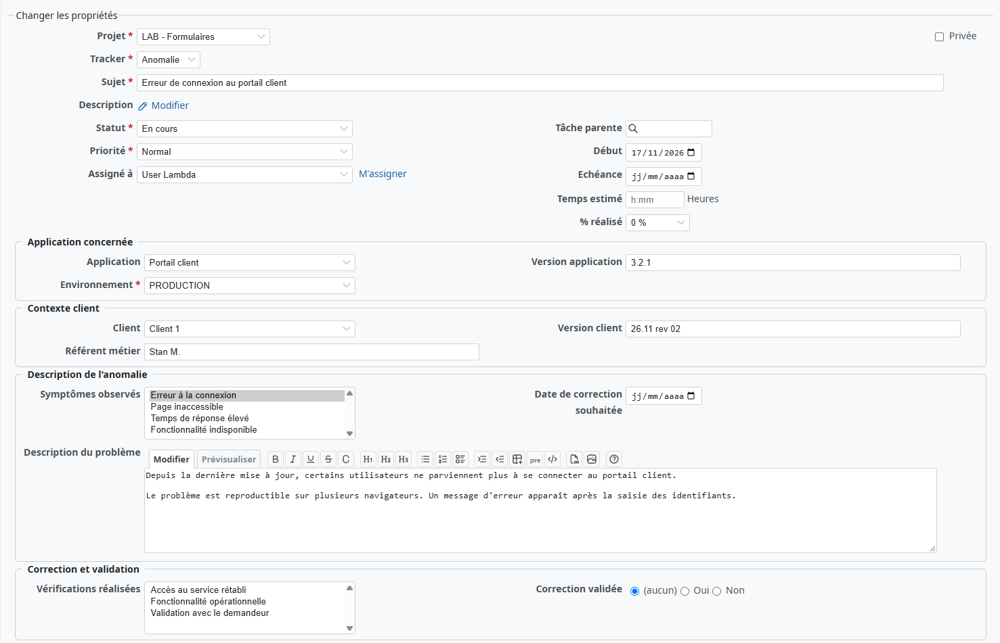
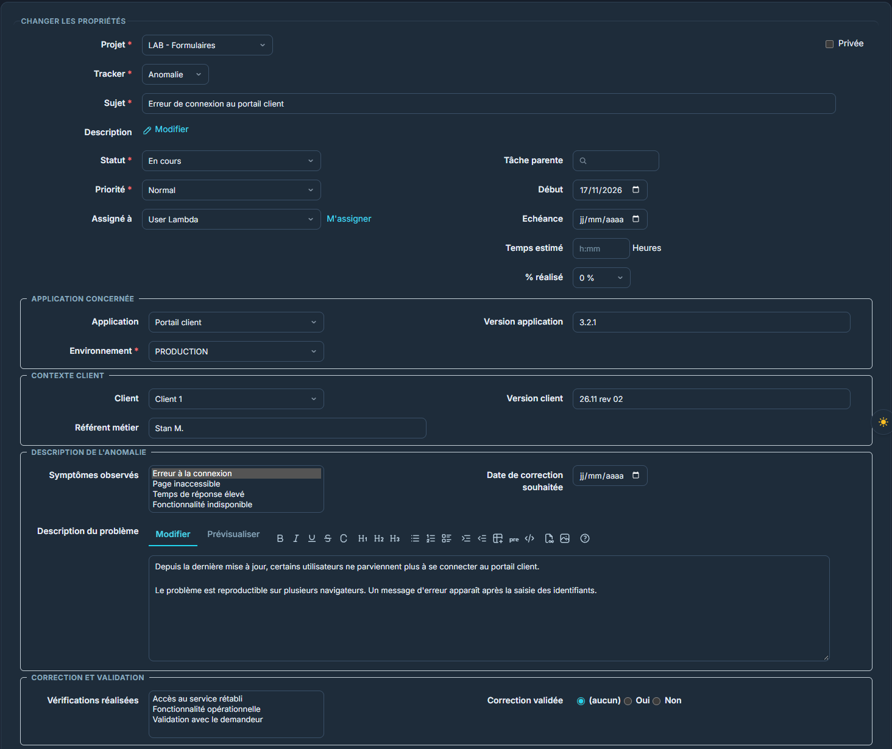
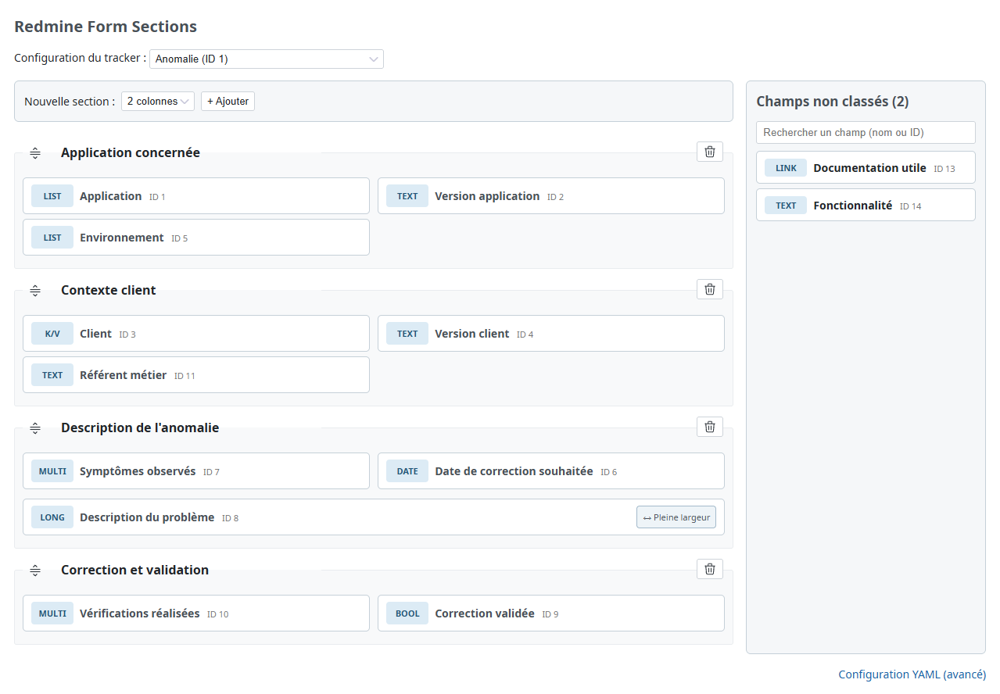
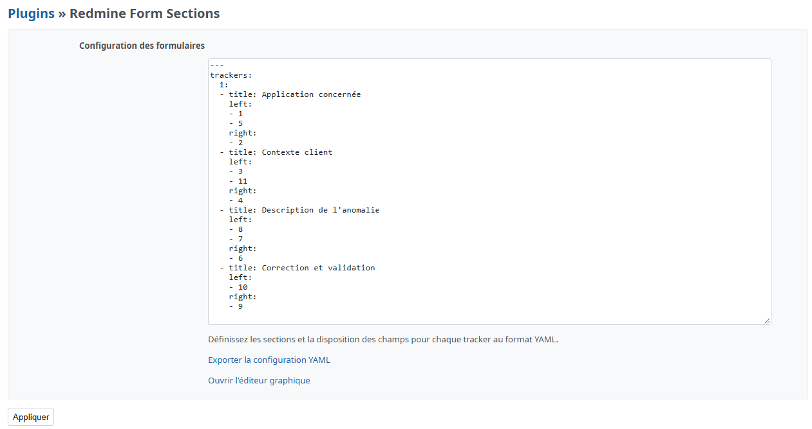

# Redmine Form Sections

[🇬🇧 English documentation](README.md)

Redmine Form Sections est un plugin permettant de personnaliser la disposition des champs personnalisés (*Custom Fields*) dans les formulaires Redmine.

Il permet de regrouper ces champs dans des sections nommées, organisées sur une ou deux colonnes.

**Le plugin agit exclusivement sur les champs personnalisés.** Les champs natifs de Redmine (Sujet, Description, Statut, Priorité, Assigné à, etc.) conservent leur disposition habituelle.

## Fonctionnalités

- Configuration des sections par tracker à l'aide d'un éditeur graphique intégré.
- Création, renommage et suppression des sections, avec réorganisation par glisser-déposer.
- Répartition et réorganisation visuelle des champs personnalisés sur une ou deux colonnes.
- Recherche parmi les champs non classés.
- Activation du plugin individuellement par projet.
- Validation avant enregistrement et détection des modifications concurrentes.
- Consultation, modification et export de la configuration YAML pour les usages avancés.
- Interface d'administration disponible en français et en anglais.

Le plugin réorganise les champs existants dans le formulaire. Il ne modifie ni leur définition ni leurs valeurs.

## Aperçu

### Formulaire Redmine natif

Par défaut, Redmine répartit les champs personnalisés sur deux colonnes, selon leur ordre de configuration.


### Formulaire organisé avec Redmine Form Sections

Le plugin permet de regrouper les champs personnalisés dans des sections fonctionnelles, avec une disposition sur une ou deux colonnes.



### Compatibilité avec les thèmes Redmine

Les sections s'adaptent aux différents thèmes Redmine, notamment aux thèmes sombres.



## Éditeur graphique

**L'éditeur graphique est intégré à Redmine Form Sections 1.0.0.** Aucun plugin complémentaire n'est nécessaire.

Accéder à **Administration > Form Sections** pour configurer les sections d'un tracker sans modifier manuellement le YAML.



L'éditeur permet de :

- Sélectionner un tracker et gérer ses sections.
- Créer, renommer, supprimer et réorganiser des sections.
- Déplacer les champs personnalisés entre sections et colonnes, ou modifier leur ordre par glisser-déposer.
- Créer des sections avec une disposition sur une ou deux colonnes.
- Repérer les champs en pleine largeur et afficher ou rechercher les champs non classés.
- Enregistrer la configuration après validation, notamment des titres et des sections vides.
- Détecter une modification de la configuration enregistrée depuis l'ouverture de l'éditeur, afin d'éviter l'écrasement involontaire des changements d'un autre administrateur.

Les titres des sections et les noms des champs affichés sur la capture proviennent de l'instance Redmine : ils ne dépendent pas de la langue de l'interface.

## Configuration YAML avancée

La même configuration reste accessible au format YAML depuis **Administration > Plugins > Redmine Form Sections > Configurer**. Cet accès est surtout utile pour la consultation, la sauvegarde, l'export ou le dépannage avancé.

L'éditeur graphique propose également un lien secondaire **Configuration YAML (avancé)**.



Les deux interfaces utilisent la même configuration enregistrée : aucune synchronisation supplémentaire n'est nécessaire.

## Comportement des formulaires

- Un tracker absent de la configuration conserve le formulaire Redmine natif.
- Un tracker déclaré avec une liste de sections vide (`1: []`) conserve également le formulaire natif.
- Une section sans champ présent dans le formulaire n'est pas affichée.
- Les champs non affectés à une section sont regroupés dans une section « Autres champs », lorsqu'ils sont présents.
- Les champs absents du formulaire ne sont pas ajoutés artificiellement.

## Compatibilité

Version du plugin : **1.0.0**

Testé avec Redmine **4.1.2**, **4.2.6** et **7.0.3**.

Le plugin a également été testé avec différents thèmes, notamment le thème par défaut de Redmine. La compatibilité avec les autres versions de Redmine n'est pas garantie.

## Installation

1. Copier le répertoire `redmine_form_sections` dans le répertoire `plugins` de Redmine.
2. Redémarrer Redmine.
3. Dans **Administration > Plugins**, vérifier que « Redmine Form Sections » apparaît dans la liste.
4. Accéder à **Administration > Form Sections** pour ouvrir l'éditeur graphique.

Seul le répertoire du plugin `redmine_form_sections` est nécessaire. Aucun plugin d'édition graphique séparé ni aucune migration de base de données ne sont requis.

## Mise à jour

Avant de mettre à jour le plugin, il est recommandé de :

1. Vérifier la compatibilité de la nouvelle version avec la version de Redmine utilisée.
2. Exporter la configuration YAML depuis **Administration > Plugins > Redmine Form Sections > Configurer**.
3. Sauvegarder le répertoire du plugin actuellement installé, ainsi que le fichier `config/form_layouts.yml` s'il a été personnalisé.
4. Prévoir un redémarrage de Redmine.

### Procédure (y compris depuis la version 0.1.1)

1. Arrêter les instances Redmine concernées selon la procédure d'exploitation habituelle.
2. Remplacer le répertoire `plugins/redmine_form_sections` par celui de la nouvelle version, en conservant exactement le même nom de répertoire.
3. Redémarrer Redmine.
4. Dans **Administration > Plugins**, vérifier que la version 1.0.0 est détectée et qu'un seul plugin Redmine Form Sections est installé.
5. Vérifier la conservation de la configuration YAML, l'ouverture de l'éditeur graphique et le fonctionnement des formulaires personnalisés.

### Conservation de la configuration

La configuration YAML enregistrée depuis l'administration est stockée dans les paramètres de Redmine, en base de données.

Elle est donc normalement conservée lors du remplacement des fichiers du plugin.

**Attention :** si le fichier `config/form_layouts.yml` a été personnalisé directement, ses modifications doivent être conservées lors de la mise à jour.

L'export YAML préalable constitue une sauvegarde supplémentaire permettant de restaurer facilement la configuration.

### Environnements avec plusieurs serveurs applicatifs

Lorsque le répertoire `plugins` est partagé entre plusieurs serveurs applicatifs (NFS, par exemple), les fichiers du plugin ne doivent être déployés qu'une seule fois sur le stockage partagé.

En revanche, toutes les instances applicatives doivent être redémarrées afin de charger la nouvelle version.

### Migration de base de données

Le passage de la version 0.1.1 à la version 1.0.0 ne nécessite aucune migration de base de données. Le format de configuration YAML existant est conservé.

### Retour arrière

En cas de problème :

1. Restaurer le répertoire de la version précédente.
2. Redémarrer les instances Redmine concernées.
3. Vérifier le fonctionnement des formulaires.

La configuration YAML enregistrée dans Redmine est conservée.

## Activation

La disposition des sections est configurée de manière centralisée par tracker, mais le module du plugin doit être activé sur chaque projet où elle doit s'appliquer. Les projets sur lesquels il est désactivé conservent le formulaire natif Redmine.

### Activer le module sur un projet

1. Ouvrir le projet.
2. Accéder à **Configuration > Modules**.
3. Cocher **Form Sections**.
4. Enregistrer.

### Activer le module par défaut pour les nouveaux projets

Accéder à **Administration > Configuration > Projets**, puis cocher **Form Sections** dans **Modules activés par défaut pour les nouveaux projets**. Enregistrer.

**Ce réglage concerne uniquement les projets créés ensuite.** Les projets existants ne sont pas modifiés.

### Activer le module sur tous les projets existants

Un administrateur peut activer le module en masse avec le *Rails runner* de Redmine. C'est préférable à une insertion directe en base : la méthode native `Project#enable_module!` conserve les autres modules et ignore les projets pour lesquels le module est déjà actif.

**1. Vérifier combien de projets sont concernés (lecture seule) :**

```bash
RAILS_ENV=production bundle exec rails runner '
  name = "redmine_form_sections"
  total = Project.count
  missing = 0
  Project.find_each { |project| missing += 1 unless project.module_enabled?(name) }
  puts "#{missing} projets à activer sur #{total}"
'
```

**2. Après vérification du résultat et sauvegarde de la base, activer le module :**

```bash
RAILS_ENV=production bundle exec rails runner '
  name = "redmine_form_sections"
  updated = 0
  Project.find_each do |project|
    next if project.module_enabled?(name)
    project.enable_module!(name)
    updated += 1
  end
  puts "Module activé sur #{updated} projets"
'
```

Exécuter ces commandes depuis le répertoire de l'application Redmine, avec son environnement Ruby habituel. Sous Docker, lancer le *Rails runner* dans le conteneur applicatif Redmine. Tester d'abord l'opération sur un environnement hors production.

La commande concerne tous les projets existants, y compris les projets archivés ou fermés. Elle ne définit **pas** les modules par défaut des futurs projets : utiliser le réglage précédent pour cela.

## Désactivation

Le plugin peut être désactivé sans être désinstallé et sans perdre la configuration des formulaires.

### Désactiver le module sur un projet

1. Ouvrir le projet.
2. Accéder à **Configuration > Modules**.
3. Décocher **Form Sections**.
4. Enregistrer.

Le projet retrouve immédiatement la présentation native des formulaires Redmine.

### Désactiver le module sur tous les projets existants

Un administrateur peut désactiver le module en masse avec le *Rails runner* de Redmine.

**1. Vérifier combien de projets sont concernés (lecture seule) :**

```bash
RAILS_ENV=production bundle exec rails runner '
  name = "redmine_form_sections"
  count = EnabledModule.where(name: name).count
  puts "Module actif sur #{count} projets"
'
```

**2. Après vérification et sauvegarde de la base de données, désactiver le module :**

```bash
RAILS_ENV=production bundle exec rails runner '
  name = "redmine_form_sections"
  updated = 0

  Project.find_each do |project|
    next unless project.module_enabled?(name)

    project.disable_module!(name)
    updated += 1
  end

  puts "Module désactivé sur #{updated} projets"
'
```

Exécuter ces commandes depuis le répertoire de l'application Redmine, avec son environnement Ruby habituel. Sous Docker, lancer le *Rails runner* dans le conteneur applicatif Redmine.

Pour éviter l'activation automatique du module sur les nouveaux projets, accéder également à **Administration > Configuration > Projets** et décocher **Form Sections** dans les modules activés par défaut.

La désactivation conserve la configuration YAML et ne supprime aucun champ personnalisé. Le module peut être réactivé ultérieurement sans reconfigurer les sections.

**Attention :** vider simplement la configuration YAML n'est pas une méthode de désactivation recommandée. Le plugin dispose d'un mécanisme de repli sur le fichier `config/form_layouts.yml` lorsqu'aucune configuration enregistrée n'est exploitable.

## Désinstallation

Pour désinstaller complètement Redmine Form Sections :

1. Exporter la configuration YAML depuis **Administration > Plugins > Redmine Form Sections > Configurer**.
2. Effectuer une sauvegarde de la base de données.
3. Désactiver le module sur les projets existants, comme indiqué précédemment.
4. Retirer **Form Sections** des modules activés par défaut pour les nouveaux projets.
5. Arrêter Redmine.
6. Supprimer le répertoire `plugins/redmine_form_sections`.
7. Redémarrer Redmine.

Dans une installation Docker, supprimer également le montage du plugin dans la configuration Docker Compose avant de recréer le conteneur.

Le plugin ne possède aucune migration de base de données. Aucune opération de retour arrière des migrations n'est donc nécessaire.

La désinstallation ne supprime ni les projets, ni les tickets, ni les champs personnalisés Redmine.

Les paramètres enregistrés par le plugin peuvent subsister dans la base de données. Ils sont volontairement conservés par cette procédure afin de faciliter une éventuelle réinstallation.

## Référence de configuration (YAML)

Pour l'administration courante, utiliser l'éditeur graphique accessible depuis **Administration > Form Sections**. La référence ci-dessous décrit le format YAML utilisé par le plugin, également accessible depuis **Administration > Plugins > Redmine Form Sections > Configurer**.

La configuration enregistrée dans les paramètres du plugin est prioritaire.

Le fichier `config/form_layouts.yml` fournit la configuration initiale et sert de repli lorsqu'aucune configuration enregistrée n'est exploitable.

La configuration est commune à tous les projets utilisant un même tracker.

### Exemple de configuration

```yaml
trackers:
  1:
    - title: "Application"
      left: [1, 2]
      right: [5]

    - title: "Client"
      left: [3, 4]
      right: [6, 7]
```

Dans cet exemple :

- `trackers` contient les configurations des différents trackers.
- `1` est l'identifiant du tracker Redmine.
- `title` définit le titre de la section.
- `left` contient les identifiants des champs personnalisés à afficher dans la colonne de gauche.
- `right` contient les identifiants des champs personnalisés à afficher dans la colonne de droite.

**Les nombres indiqués dans `left` et `right` correspondent aux identifiants des champs personnalisés Redmine (Custom Field IDs), et non à leur position dans le formulaire.**

Plusieurs champs peuvent être placés dans une même colonne en séparant leurs identifiants par des virgules.

Par exemple :

```yaml
left: [12, 15, 23]
```

Cette configuration place successivement les champs personnalisés 12, 15 et 23 dans la colonne de gauche.

**L'ordre des identifiants détermine l'ordre d'affichage des champs dans la colonne.**

### Identifier un champ personnalisé

Dans Redmine :

1. Accéder à **Administration > Champs personnalisés**.
2. Sélectionner le champ personnalisé concerné.
3. Repérer son identifiant dans l'URL.

Exemple :

`https://redmine.exemple.fr/custom_fields/123/edit`

Dans cet exemple, l'identifiant du champ personnalisé est `123`.

### Organisation des colonnes

Si `right` est déclaré, la section utilise deux colonnes, même si l'une des listes est vide.

Exemple :

```yaml
- title: "Application"
  left: [1, 2]
  right: []
```

La section utilise deux colonnes, mais seule celle de gauche contient des champs.

Si seul `left` est déclaré, la section utilise une colonne sur toute la largeur disponible.

Exemple :

```yaml
- title: "Application"
  left: [1, 2]
```

La colonne `left` est obligatoire.

Une section doit déclarer au moins un champ personnalisé.

Un même champ personnalisé ne peut pas être déclaré plusieurs fois pour un même tracker.

Chaque section doit posséder un titre (`title`) non vide.

Seules les propriétés `title`, `left` et `right` sont autorisées dans une section. Toute propriété inconnue provoque une erreur de validation.

### Champs personnalisés en pleine largeur

Le plugin respecte l'option native de Redmine permettant d'afficher un champ personnalisé sur toute la largeur du formulaire.

Lorsqu'un champ est configuré en pleine largeur dans Redmine :

- Il peut être déclaré indifféremment dans `left` ou `right` dans le YAML.
- Il est affiché sous les colonnes de la section correspondante, sur toute la largeur disponible.
- S'il n'est déclaré dans aucune section, il est placé à la fin de la section automatique « Autres champs ».
- Si une section contient uniquement des champs en pleine largeur, aucune structure de colonnes inutile n'est créée.

Le plugin conserve les contrôles HTML générés par Redmine, y compris les éditeurs de texte avec formatage.

Cette personnalisation concerne exclusivement les champs personnalisés. Les champs natifs de Redmine ne sont pas réorganisés.

## Export de la configuration

L'écran d'administration permet de télécharger la configuration YAML.

L'export est réservé aux administrateurs Redmine.

## Tests

Le code source contient des tests unitaires et des tests d'intégration.

Ils permettent notamment de vérifier :

- La validation des configurations YAML.
- La détection des configurations incorrectes.
- Le comportement de l'administration et la validation dans l'éditeur graphique.
- La détection des modifications réalisées par un autre administrateur avant l'enregistrement.
- L'export et ses restrictions d'accès.

Ces tests ne sont pas nécessaires au fonctionnement normal du plugin.

## Limitations actuelles

- La configuration des sections est définie par tracker. Elle est commune à tous les projets utilisant ce tracker.
- La disposition des champs natifs de Redmine (Sujet, Description, Statut, Priorité, etc.) n'est pas personnalisable.
- Le plugin réorganise uniquement les champs personnalisés effectivement présents dans le formulaire.
- Le rendu dépend du thème Redmine utilisé. Des différences mineures de présentation peuvent apparaître selon les thèmes.
- La compatibilité a été testée sur les versions de Redmine indiquées ci-dessus ; d’autres versions peuvent se comporter différemment.

L'éditeur graphique est intégré au plugin ; il ne change pas les limites décrites ci-dessus.

## Auteur

Julien Maisonnas

## Licence

Copyright (C) 2026 Julien Maisonnas

Redmine Form Sections est distribué sous les termes de la GNU General Public License, version 2 ou ultérieure (GPL-2.0-or-later).

Voir le fichier [LICENSE](LICENSE) pour le texte intégral de la licence.
