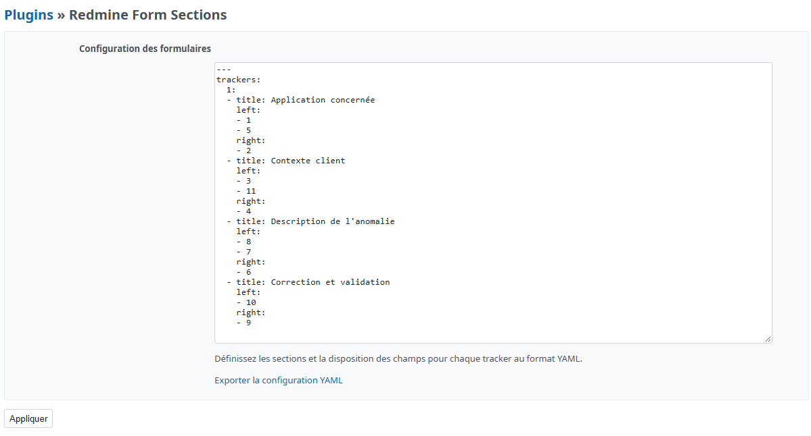

# Redmine Form Sections

[🇬🇧 English documentation](README.md)

Redmine Form Sections est un plugin permettant de personnaliser la disposition des champs personnalisés (*Custom Fields*) dans les formulaires Redmine.

Il permet de regrouper ces champs dans des sections nommées, organisées sur une ou deux colonnes.

**Le plugin agit exclusivement sur les champs personnalisés.** Les champs natifs de Redmine (Sujet, Description, Statut, Priorité, Assigné à, etc.) conservent leur disposition habituelle.

## Fonctionnalités

- Configuration des sections par tracker.
- Disposition sur une ou deux colonnes.
- Activation du plugin individuellement par projet.
- Configuration centralisée au format YAML.
- Validation de la configuration avant enregistrement.
- Détection des identifiants de champs déclarés plusieurs fois.
- Export de la configuration YAML.
- Interface disponible en français et en anglais.

Le plugin réorganise les champs existants dans le formulaire. Il ne modifie ni leur définition ni leurs valeurs.

## Aperçu

### Formulaire Redmine natif

Par défaut, Redmine répartit les champs personnalisés sur deux colonnes, selon leur ordre de configuration.


### Formulaire organisé avec Redmine Form Sections

Le plugin permet de regrouper les champs personnalisés dans des sections fonctionnelles, avec une disposition sur une ou deux colonnes.


### Compatibilité avec les thèmes Redmine

Les sections s'adaptent aux différents thèmes Redmine, notamment aux thèmes sombres.


### Configuration YAML

L'organisation des sections peut être définie directement depuis l'administration de Redmine, au format YAML.



Pour une administration graphique par glisser-déposer, consultez le plugin complémentaire **Redmine Form Sections PRO**.

## Éditeur visuel — Redmine Form Sections PRO

Pour faciliter l'administration des formulaires, un plugin complémentaire est disponible : **Redmine Form Sections PRO**.

Il propose une interface graphique permettant de configurer les sections sans avoir à modifier manuellement le YAML.

### Fonctionnalités supplémentaires

- Création, modification et suppression des sections.
- Organisation des champs personnalisés par glisser-déposer.
- Répartition des champs sur une ou deux colonnes.
- Réorganisation des sections et des champs.
- Visualisation des champs non classés.
- Recherche dynamique parmi les champs non classés.
- Enregistrement de la configuration.

Le plugin PRO s'appuie sur Redmine Form Sections FREE.

**Le plugin FREE reste indispensable :** il assure l'application de la configuration aux formulaires Redmine. Le plugin PRO fournit une interface d'administration complémentaire, mais n'est pas nécessaire au fonctionnement du plugin FREE.

Les deux plugins peuvent être installés ensemble.

### Comportement

- Un tracker absent de la configuration conserve le formulaire Redmine natif.
- Un tracker déclaré avec une liste de sections vide (`1: []`) conserve également le formulaire natif.
- Une section sans champ présent dans le formulaire n'est pas affichée.
- Les champs non affectés à une section sont regroupés dans une section « Autres champs », lorsqu'ils sont présents.
- Les champs absents du formulaire ne sont pas ajoutés artificiellement.

## Compatibilité

Version du plugin : **0.1.1**

Versions de Redmine testées :

- Redmine 4.1.2
- Redmine 4.2.6
- Redmine 7.0.3

Le plugin a été testé avec différents thèmes, notamment le thème par défaut de Redmine.

La compatibilité avec les autres versions de Redmine n'est pas garantie.

## Installation

1. Copier le répertoire `redmine_form_sections` dans le répertoire `plugins` de Redmine.
2. Redémarrer Redmine.
3. Dans **Administration > Plugins**, vérifier que « Redmine Form Sections » apparaît dans la liste.

Aucune migration de base de données n'est nécessaire pour cette version du plugin.

## Mise à jour

Avant de mettre à jour le plugin, il est recommandé de :

1. Vérifier la compatibilité de la nouvelle version avec la version de Redmine utilisée.
2. Exporter la configuration YAML depuis **Administration > Plugins > Redmine Form Sections > Configurer**.
3. Sauvegarder le répertoire du plugin actuellement installé, ainsi que le fichier `config/form_layouts.yml` s'il a été personnalisé.
4. Prévoir un redémarrage de Redmine.

### Procédure

1. Arrêter les instances Redmine concernées selon la procédure d'exploitation habituelle.
2. Remplacer le répertoire `plugins/redmine_form_sections` par celui de la nouvelle version, en conservant exactement le même nom de répertoire.
3. Redémarrer Redmine.
4. Dans **Administration > Plugins**, vérifier que la nouvelle version est détectée.
5. Vérifier que la configuration YAML existante est conservée et que les formulaires personnalisés fonctionnent correctement.

### Conservation de la configuration

La configuration YAML enregistrée depuis l'administration est stockée dans les paramètres de Redmine, en base de données.

Elle est donc normalement conservée lors du remplacement des fichiers du plugin.

**Attention :** si le fichier `config/form_layouts.yml` a été personnalisé directement, ses modifications doivent être conservées lors de la mise à jour.

L'export YAML préalable constitue une sauvegarde supplémentaire permettant de restaurer facilement la configuration.

### Environnements avec plusieurs serveurs applicatifs

Lorsque le répertoire `plugins` est partagé entre plusieurs serveurs applicatifs (NFS, par exemple), les fichiers du plugin ne doivent être déployés qu'une seule fois sur le stockage partagé.

En revanche, toutes les instances applicatives doivent être redémarrées afin de charger la nouvelle version.

### Migration de base de données

Le passage de la version 0.1.0 à la version 0.1.1 ne nécessite aucune migration de base de données.

### Retour arrière

En cas de problème :

1. Restaurer le répertoire de la version précédente.
2. Redémarrer les instances Redmine concernées.
3. Vérifier le fonctionnement des formulaires.

La configuration YAML enregistrée dans Redmine est conservée.

## Activation

Le plugin doit être activé sur chaque projet concerné.

1. Ouvrir le projet.
2. Accéder à **Configuration > Modules**.
3. Activer **Personnalisation des formulaires**.
4. Enregistrer.

Les projets sur lesquels le module est désactivé conservent le comportement natif de Redmine.

## Configuration

Accéder à **Administration > Plugins > Redmine Form Sections > Configurer**.

La disposition des champs personnalisés est définie au format YAML.

La configuration enregistrée dans les paramètres du plugin est prioritaire.

Le fichier `config/form_layouts.yml` fournit la configuration initiale et sert de repli lorsqu'aucune configuration enregistrée n'est exploitable.

La configuration est commune à tous les projets utilisant un même tracker.

### Exemple de configuration

```yaml
trackers:
  1:
    - title: "Application"
      left: [1, 2]
      right: [5]

    - title: "Client"
      left: [3, 4]
      right: [6, 7]
```

Dans cet exemple :

- `trackers` contient les configurations des différents trackers.
- `1` est l'identifiant du tracker Redmine.
- `title` définit le titre de la section.
- `left` contient les identifiants des champs personnalisés à afficher dans la colonne de gauche.
- `right` contient les identifiants des champs personnalisés à afficher dans la colonne de droite.

**Les nombres indiqués dans `left` et `right` correspondent aux identifiants des champs personnalisés Redmine (Custom Field IDs), et non à leur position dans le formulaire.**

Plusieurs champs peuvent être placés dans une même colonne en séparant leurs identifiants par des virgules.

Par exemple :

```yaml
left: [12, 15, 23]
```

Cette configuration place successivement les champs personnalisés 12, 15 et 23 dans la colonne de gauche.

**L'ordre des identifiants détermine l'ordre d'affichage des champs dans la colonne.**

### Identifier un champ personnalisé

Dans Redmine :

1. Accéder à **Administration > Champs personnalisés**.
2. Sélectionner le champ personnalisé concerné.
3. Repérer son identifiant dans l'URL.

Exemple :

`https://redmine.exemple.fr/custom_fields/123/edit`

Dans cet exemple, l'identifiant du champ personnalisé est `123`.

### Organisation des colonnes

Si `right` est déclaré, la section utilise deux colonnes, même si l'une des listes est vide.

Exemple :

```yaml
- title: "Application"
  left: [1, 2]
  right: []
```

La section utilise deux colonnes, mais seule celle de gauche contient des champs.

Si seul `left` est déclaré, la section utilise une colonne sur toute la largeur disponible.

Exemple :

```yaml
- title: "Application"
  left: [1, 2]
```

La colonne `left` est obligatoire.

Une section doit déclarer au moins un champ personnalisé.

Un même champ personnalisé ne peut pas être déclaré plusieurs fois pour un même tracker.

Chaque section doit posséder un titre (`title`) non vide.

Seules les propriétés `title`, `left` et `right` sont autorisées dans une section. Toute propriété inconnue provoque une erreur de validation.

### Champs personnalisés en pleine largeur

Le plugin respecte l'option native de Redmine permettant d'afficher un champ personnalisé sur toute la largeur du formulaire.

Lorsqu'un champ est configuré en pleine largeur dans Redmine :

- Il peut être déclaré indifféremment dans `left` ou `right` dans le YAML.
- Il est affiché sous les colonnes de la section correspondante, sur toute la largeur disponible.
- S'il n'est déclaré dans aucune section, il est placé à la fin de la section automatique « Autres champs ».
- Si une section contient uniquement des champs en pleine largeur, aucune structure de colonnes inutile n'est créée.

Le plugin conserve les contrôles HTML générés par Redmine, y compris les éditeurs de texte avec formatage.

Cette personnalisation concerne exclusivement les champs personnalisés. Les champs natifs de Redmine ne sont pas réorganisés.

## Export de la configuration

L'écran d'administration permet de télécharger la configuration YAML.

L'export est réservé aux administrateurs Redmine.

## Tests

Le code source contient des tests unitaires et des tests d'intégration.

Ils permettent notamment de vérifier :

- La validation des configurations YAML.
- La détection des configurations incorrectes.
- Le comportement de l'administration.
- L'export et ses restrictions d'accès.

Ces tests ne sont pas nécessaires au fonctionnement normal du plugin.

## Limitations actuelles

- La configuration des sections est définie par tracker. Elle est commune à tous les projets utilisant ce tracker.
- La disposition des champs natifs de Redmine (Sujet, Description, Statut, Priorité, etc.) n'est pas personnalisable.
- Le plugin réorganise uniquement les champs personnalisés effectivement présents dans le formulaire.
- Le rendu dépend du thème Redmine utilisé. Des différences mineures de présentation peuvent apparaître selon les thèmes.
- La compatibilité est vérifiée uniquement sur les versions de Redmine mentionnées dans la section « Compatibilité ».

L'administration graphique des sections est disponible avec le plugin complémentaire **Redmine Form Sections PRO**.

## Auteur

Julien Maisonnas

## Licence

Copyright (C) 2026 Julien Maisonnas

Redmine Form Sections est distribué sous les termes de la GNU General Public License, version 2 ou ultérieure (GPL-2.0-or-later).

Voir le fichier [LICENSE](LICENSE) pour le texte intégral de la licence.
