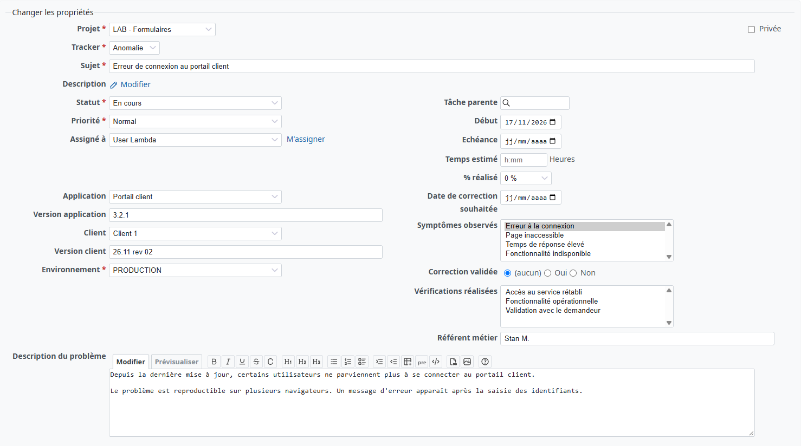
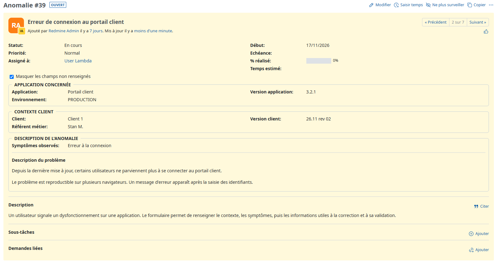
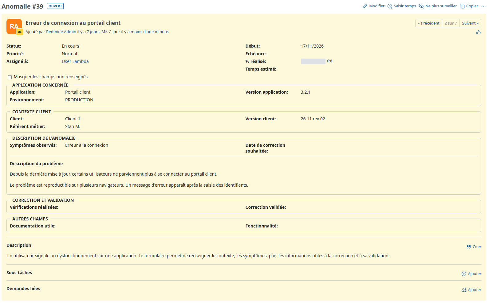

# Redmine Form Sections

[🇬🇧 English documentation](README.md)

Redmine Form Sections organise les champs personnalisés (*Custom Fields*) des tickets Redmine, en création, en modification et en consultation.

Il permet de regrouper ces champs dans des sections nommées, organisées sur une ou deux colonnes.

**Le plugin agit exclusivement sur les champs personnalisés.** Les attributs natifs de Redmine, la description et les pièces jointes conservent leur disposition habituelle.

## Fonctionnalités

- Configuration d'une disposition par tracker pour les trois vues du ticket, à l'aide d'un éditeur graphique intégré.
- Création, renommage et suppression des sections, avec réorganisation par glisser-déposer.
- Répartition et réorganisation visuelle des champs personnalisés sur une ou deux colonnes.
- Recherche parmi les champs non classés.
- Activation du plugin individuellement par projet.
- Filtre des champs non renseignés en consultation, coché par défaut.
- Validation avant enregistrement et détection des modifications concurrentes.
- Consultation, modification et export de la configuration YAML pour les usages avancés.
- Interface d'administration disponible en français et en anglais.

Le plugin réorganise les champs présents dans chaque vue. Leurs définitions et leurs valeurs restent gérées par Redmine.

## Aperçu visuel

### Formulaire Redmine natif

Par défaut, Redmine répartit les champs personnalisés sur deux colonnes, selon leur ordre de configuration.



### Formulaire organisé avec Redmine Form Sections

Le plugin permet de regrouper les champs personnalisés dans des sections fonctionnelles, avec une disposition sur une ou deux colonnes.


### Compatibilité avec les thèmes Redmine

Le rendu a été vérifié sur Redmine 7.0.3 avec le thème par défaut et Modern Redmine Theme.


### Le filtre en consultation

**Filtre activé (comportement par défaut)**



**Filtre désactivé (tous les champs restitués par Redmine)**



### Aperçu de l’éditeur graphique


## Compatibilité

Version du plugin : **1.0.0**

| Version de Redmine | Validation effectuée |
| --- | --- |
| **4.1.2** | Recette manuelle de la consultation, y compris des champs pleine largeur. |
| **7.0.3** | Version utilisée pour le développement, les tests automatisés et la recette manuelle, dont la consultation et la réinitialisation de la configuration. |

La compatibilité de l'ensemble des fonctionnalités décrites avec Redmine 4.2.x et les autres versions reste à vérifier.

## Installation et démarrage rapide

Seul le répertoire du plugin `redmine_form_sections` est nécessaire. Aucun plugin d'édition graphique séparé ni aucune migration de base de données ne sont requis.

1. Copier le répertoire `redmine_form_sections` dans le répertoire `plugins` de Redmine.
2. Redémarrer Redmine.
3. Dans **Administration > Plugins**, vérifier que « Redmine Form Sections » apparaît dans la liste.
4. Accéder à **Administration > Form Sections** et enregistrer une disposition pour un tracker.
5. [Activer le module](#activer-le-module-sur-un-projet) dans chaque projet concerné.
6. Ouvrir un ticket du tracker configuré dans ce projet pour retrouver les sections.

### Activer le module sur un projet

1. Ouvrir le projet.
2. Accéder à **Configuration > Modules**.
3. Cocher **Form Sections**.
4. Enregistrer.

À la première installation, la configuration est vide (`trackers: {}`). L'activation du module seule laisse les tickets dans leur présentation native.

## Présentation des tickets

Le module doit être actif dans le projet et le tracker doit avoir une disposition valide comportant au moins une section. La même disposition s'applique en création, en modification et en consultation. Sans disposition applicable, Redmine affiche le ticket dans sa présentation native.

Les titres des sections s'affichent en majuscules. Le texte enregistré dans la configuration est conservé.

### Création et modification

- La disposition fixe l'ordre des sections, le nombre de colonnes et l'ordre des champs dans chaque colonne.
- Les champs présents et non affectés à une section rejoignent une dernière section « Autres champs ». Une section sans champ présent n'est pas affichée.
- Le plugin déplace les contrôles générés par Redmine, y compris les éditeurs de texte avec formatage. Redmine continue de gérer les champs disponibles pour le projet et le tracker, les permissions, la validation et l'enregistrement des valeurs.

### Consultation

- Les sections prennent la place du bloc des champs personnalisés ordinaires, avant la description. Elles regroupent uniquement les champs que Redmine a déjà rendus pour l'utilisateur. Les règles de visibilité, les libellés, les liens et le formatage des valeurs sont conservés.
- Les champs ordinaires suivent la disposition configurée et les champs pleine largeur apparaissent sous les colonnes de leur section. Un champ pleine largeur vide que Redmine omet reste absent. Les champs rendus qui ne sont pas classés rejoignent « Autres champs ».
- La case **Masquer les champs non renseignés** est cochée par défaut. Elle masque les champs vides et les sections qui ne contiennent plus de champ visible. Une valeur `0`, « Non » ou une image visible compte comme renseignée.
- Décocher la case réaffiche les champs masqués sans recharger la page. La case reste accessible même si toutes les sections sont masquées. Chaque nouvelle consultation réactive le filtre, sans enregistrer de préférence.

## Administration

### Éditeur graphique

**L'éditeur graphique est intégré à Redmine Form Sections 1.0.0.** Aucun plugin complémentaire n'est nécessaire.

Accéder à **Administration > Form Sections** pour configurer les sections d'un tracker sans modifier manuellement le YAML.

L'éditeur permet de :

- Sélectionner un tracker et gérer ses sections.
- Créer, renommer, supprimer et réorganiser des sections.
- Déplacer les champs personnalisés entre sections et colonnes, ou modifier leur ordre par glisser-déposer.
- Créer des sections avec une disposition sur une ou deux colonnes.
- Repérer les champs en pleine largeur et afficher ou rechercher les champs non classés.
- Enregistrer la configuration après validation, notamment des titres et des sections vides.
- Détecter une modification de la configuration enregistrée depuis l'ouverture de l'éditeur, afin d'éviter l'écrasement involontaire des changements d'un autre administrateur.

Les titres des sections et les noms des champs affichés sur la capture proviennent de l'instance Redmine : ils ne dépendent pas de la langue de l'interface.

### Configuration YAML avancée

La même configuration peut être consultée, modifiée et exportée au format YAML depuis **Administration > Plugins > Redmine Form Sections > Configurer**.

L'éditeur graphique propose également un lien secondaire **Configuration YAML (avancé)**.


Les deux interfaces utilisent la même configuration enregistrée. Si le YAML saisi est invalide, l'enregistrement est refusé et l'erreur est affichée. Si une configuration invalide est déjà présente en base, les tickets utilisent le rendu natif. L'éditeur graphique signale le problème et l'enregistrement y reste bloqué jusqu'à la correction du YAML dans les paramètres du plugin.

### Réinitialiser la configuration

- **Pour un tracker**, supprimer toutes ses sections dans l'éditeur graphique et enregistrer. En YAML, supprimer l'entrée du tracker ou lui attribuer une liste vide, par exemple `1: []`.
- **Pour tous les trackers**, enregistrer `trackers: {}` dans la configuration YAML avancée. Dans l'éditeur graphique, supprimer les sections et enregistrer pour chaque tracker configuré.

Les tickets concernés retrouvent leur présentation native dès la prochaine ouverture en création, en modification ou en consultation. Les deux interfaces restent utilisables pour créer une nouvelle disposition.

### Export de la configuration

L'écran d'administration permet de télécharger la configuration YAML.

L'export est réservé aux administrateurs Redmine.

## Mise à jour

Avant de mettre à jour le plugin, il est recommandé de :

1. Vérifier la compatibilité de la nouvelle version avec la version de Redmine utilisée.
2. Exporter la configuration YAML depuis **Administration > Plugins > Redmine Form Sections > Configurer**, si l'export est disponible dans la version installée.
3. Sauvegarder le répertoire du plugin actuellement installé.
4. Prévoir un redémarrage de Redmine.

### Procédure (y compris depuis la version 0.1.1)

1. Arrêter les instances Redmine concernées selon la procédure d'exploitation habituelle.
2. Remplacer le répertoire `plugins/redmine_form_sections` par celui de la nouvelle version, en conservant exactement le même nom de répertoire.
3. Redémarrer Redmine.
4. Dans **Administration > Plugins**, vérifier que la version 1.0.0 est détectée et qu'un seul plugin Redmine Form Sections est installé.
5. Vérifier la conservation de la configuration YAML, l'ouverture de l'éditeur graphique et la présentation des tickets.

### Conservation de la configuration

La configuration YAML valide enregistrée depuis l'administration est stockée en base de données dans les paramètres Redmine. Elle est conservée lors du remplacement des fichiers du plugin.

L'ancien fichier `config/form_layouts.yml` est supprimé. Il ne sert plus de configuration initiale ni de secours. Si vos dispositions étaient définies uniquement dans ce fichier, conservez-en une copie avant la mise à jour, puis reportez son contenu dans la configuration YAML avancée et enregistrez-le.

### Environnements avec plusieurs serveurs applicatifs

Lorsque le répertoire `plugins` est partagé entre plusieurs serveurs applicatifs (NFS, par exemple), les fichiers du plugin ne doivent être déployés qu'une seule fois sur le stockage partagé.

En revanche, toutes les instances applicatives doivent être redémarrées afin de charger la nouvelle version.

### Migration de base de données

Le passage de la version 0.1.1 à la version 1.0.0 ne nécessite aucune migration de base de données. Le format de configuration YAML existant est conservé.

### Retour arrière

En cas de problème :

1. Restaurer le répertoire de la version précédente.
2. Redémarrer les instances Redmine concernées.
3. Vérifier la présentation des tickets.

La configuration YAML enregistrée dans Redmine est conservée.

## Administration avancée

### Activation

La disposition est configurée par tracker. Activez le module dans chaque projet où elle doit s'appliquer.

#### Activer le module par défaut pour les nouveaux projets

Accéder à **Administration > Configuration > Projets**, puis cocher **Form Sections** dans **Modules activés par défaut pour les nouveaux projets**. Enregistrer.

**Ce réglage concerne uniquement les projets créés ensuite.** Les projets existants ne sont pas modifiés.

#### Activer le module sur tous les projets existants

Un administrateur peut activer le module en masse avec le *Rails runner* de Redmine. C'est préférable à une insertion directe en base : la méthode native `Project#enable_module!` conserve les autres modules et ignore les projets pour lesquels le module est déjà actif.

**1. Vérifier combien de projets sont concernés (lecture seule) :**

```bash
RAILS_ENV=production bundle exec rails runner '
  name = "redmine_form_sections"
  total = Project.count
  missing = 0
  Project.find_each { |project| missing += 1 unless project.module_enabled?(name) }
  puts "#{missing} projets à activer sur #{total}"
'
```

**2. Après vérification du résultat et sauvegarde de la base, activer le module :**

```bash
RAILS_ENV=production bundle exec rails runner '
  name = "redmine_form_sections"
  updated = 0
  Project.find_each do |project|
    next if project.module_enabled?(name)
    project.enable_module!(name)
    updated += 1
  end
  puts "Module activé sur #{updated} projets"
'
```

Exécuter ces commandes depuis le répertoire de l'application Redmine, avec son environnement Ruby habituel. Sous Docker, lancer le *Rails runner* dans le conteneur applicatif Redmine. Tester d'abord l'opération sur un environnement hors production.

La commande concerne tous les projets existants, y compris les projets archivés ou fermés. Elle ne définit **pas** les modules par défaut des futurs projets : utiliser le réglage précédent pour cela.

### Désactivation

La désactivation du module préserve la configuration des sections.

#### Désactiver le module sur un projet

1. Ouvrir le projet.
2. Accéder à **Configuration > Modules**.
3. Décocher **Form Sections**.
4. Enregistrer.

Le projet retrouve immédiatement la présentation native des tickets en création, en modification et en consultation.

#### Désactiver le module sur tous les projets existants

Un administrateur peut désactiver le module en masse avec le *Rails runner* de Redmine.

**1. Vérifier combien de projets sont concernés (lecture seule) :**

```bash
RAILS_ENV=production bundle exec rails runner '
  name = "redmine_form_sections"
  count = EnabledModule.where(name: name).count
  puts "Module actif sur #{count} projets"
'
```

**2. Après vérification et sauvegarde de la base de données, désactiver le module :**

```bash
RAILS_ENV=production bundle exec rails runner '
  name = "redmine_form_sections"
  updated = 0

  Project.find_each do |project|
    next unless project.module_enabled?(name)

    project.disable_module!(name)
    updated += 1
  end

  puts "Module désactivé sur #{updated} projets"
'
```

Exécuter ces commandes depuis le répertoire de l'application Redmine, avec son environnement Ruby habituel. Sous Docker, lancer le *Rails runner* dans le conteneur applicatif Redmine.

Pour éviter l'activation automatique du module sur les nouveaux projets, accéder également à **Administration > Configuration > Projets** et décocher **Form Sections** dans les modules activés par défaut.

La désactivation conserve la configuration YAML et ne supprime aucun champ personnalisé. Le module peut être réactivé ultérieurement sans reconfigurer les sections.

### Désinstallation

Pour désinstaller complètement Redmine Form Sections :

1. Exporter la configuration YAML depuis **Administration > Plugins > Redmine Form Sections > Configurer**.
2. Effectuer une sauvegarde de la base de données.
3. Désactiver le module sur les projets existants, comme indiqué précédemment.
4. Retirer **Form Sections** des modules activés par défaut pour les nouveaux projets.
5. Arrêter Redmine.
6. Supprimer le répertoire `plugins/redmine_form_sections`.
7. Redémarrer Redmine.

Dans une installation Docker, supprimer également le montage du plugin dans la configuration Docker Compose avant de recréer le conteneur.

Le plugin ne possède aucune migration de base de données. Aucune opération de retour arrière des migrations n'est donc nécessaire.

La désinstallation ne supprime ni les projets, ni les tickets, ni les champs personnalisés Redmine.

Les paramètres enregistrés par le plugin peuvent subsister dans la base de données. Ils sont volontairement conservés par cette procédure afin de faciliter une éventuelle réinstallation.

## Référence de configuration (YAML)

Pour l'administration courante, utiliser l'éditeur graphique accessible depuis **Administration > Form Sections**. La référence ci-dessous décrit le format YAML utilisé par le plugin, également accessible depuis **Administration > Plugins > Redmine Form Sections > Configurer**.

Seule la configuration enregistrée dans les paramètres du plugin est utilisée. La disposition d'un tracker est commune aux projets où le module est actif.

### Exemple de configuration

```yaml
trackers:
  1:
    - title: "Application"
      left: [1, 2]
      right: [5]

    - title: "Client"
      left: [3, 4]
      right: [6, 7]
```

Dans cet exemple :

- `trackers` contient les configurations des différents trackers.
- `1` est l'identifiant du tracker Redmine.
- `title` définit le titre de la section.
- `left` contient les identifiants des champs personnalisés à afficher dans la colonne de gauche.
- `right` contient les identifiants des champs personnalisés à afficher dans la colonne de droite.

**Les nombres indiqués dans `left` et `right` correspondent aux identifiants des champs personnalisés Redmine (Custom Field IDs), et non à leur position dans le formulaire.**

Plusieurs champs peuvent être placés dans une même colonne en séparant leurs identifiants par des virgules.

Par exemple :

```yaml
left: [12, 15, 23]
```

Cette configuration place successivement les champs personnalisés 12, 15 et 23 dans la colonne de gauche.

**L'ordre des identifiants détermine l'ordre d'affichage des champs dans la colonne.**

### Identifier un champ personnalisé

Dans Redmine :

1. Accéder à **Administration > Champs personnalisés**.
2. Sélectionner le champ personnalisé concerné.
3. Repérer son identifiant dans l'URL.

Exemple :

`https://redmine.exemple.fr/custom_fields/123/edit`

Dans cet exemple, l'identifiant du champ personnalisé est `123`.

### Organisation des colonnes

Si `right` est déclaré, la section utilise deux colonnes, même si l'une des listes est vide.

Exemple :

```yaml
- title: "Application"
  left: [1, 2]
  right: []
```

La section utilise deux colonnes, mais seule celle de gauche contient des champs.

Si seul `left` est déclaré, la section utilise une colonne sur toute la largeur disponible.

Exemple :

```yaml
- title: "Application"
  left: [1, 2]
```

La colonne `left` est obligatoire.

Une section doit déclarer au moins un champ personnalisé.

Un même champ personnalisé ne peut pas être déclaré plusieurs fois pour un même tracker.

Chaque section doit posséder un titre (`title`) non vide.

Seules les propriétés `title`, `left` et `right` sont autorisées dans une section. Toute propriété inconnue provoque une erreur de validation.

### Champs personnalisés en pleine largeur

Le plugin respecte l'option native de Redmine permettant d'afficher un champ personnalisé en pleine largeur.

Lorsqu'un champ est configuré en pleine largeur dans Redmine :

- Il peut être déclaré indifféremment dans `left` ou `right` dans le YAML.
- Il est affiché sous les colonnes de la section correspondante, sur toute la largeur disponible.
- S'il n'est déclaré dans aucune section, il est placé à la fin de la section automatique « Autres champs ».
- Si une section contient uniquement des champs en pleine largeur, aucune structure de colonnes inutile n'est créée.

## Tests

Les tests Ruby et Rails dans `test/unit` et `test/integration` couvrent la validation du YAML, la réinitialisation dans les deux interfaces, les conflits d'enregistrement, l'export et ses restrictions d'accès. Ils vérifient aussi les formulaires de création et de modification, le changement de tracker, le HTML de consultation et les permissions sur les champs.

Les tests JavaScript couvrent le calcul des sections, le regroupement sur les structures HTML de Redmine 4.1.2 et 7.0.3, le filtre et le repli vers le rendu natif. Exécuter les commandes suivantes depuis le répertoire du plugin, avec Node.js.

```bash
node test/javascript/section_layout_test.js
node test/javascript/issue_show_layout_test.js
```

Les tests d'intégration nécessitent une installation Redmine et une base de test dédiée. Le plugin s'installe et fonctionne dans Redmine sans Docker ni Node.js.

## Limitations actuelles

- Le regroupement dans les vues du ticket utilise JavaScript. En consultation, une structure HTML native inattendue laisse la fiche dans son rendu Redmine.
- Le rendu visuel peut varier selon le thème.

## Auteur

Julien Maisonnas

## Licence

Copyright (C) 2026 Julien Maisonnas

Redmine Form Sections est distribué sous les termes de la GNU General Public License, version 2 ou ultérieure (GPL-2.0-or-later).

Voir le fichier [LICENSE](LICENSE) pour le texte intégral de la licence.
