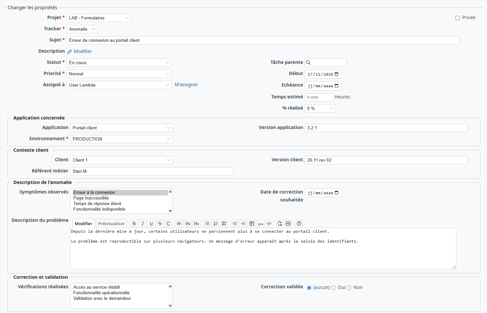

# Redmine Form Sections

[🇫🇷 Documentation en français](README.fr.md)

Redmine Form Sections is a plugin that lets you customize the layout of custom fields in Redmine issue forms.

It groups custom fields into named sections, arranged in one or two columns.

**The plugin only affects custom fields.** Native Redmine fields (Subject, Description, Status, Priority, Assignee, etc.) retain their usual layout.

## Features

- Configure sections for each tracker using a built-in visual editor.
- Create, rename, and delete sections; reorder sections with drag and drop.
- Arrange custom fields in one or two columns, and reorder them visually.
- Find unclassified fields using a search box.
- Enable the plugin independently for each project.
- Validate configuration before saving and detect concurrent edits.
- View, edit, and export the YAML configuration when advanced access is needed.
- Use the administration interface in French or English.

The plugin rearranges existing fields in the form. It does not change their definitions or values.

## Screenshots

### Native Redmine form

By default, Redmine arranges custom fields in two columns according to their configured order.


### Form organized with Redmine Form Sections

The plugin groups custom fields into functional sections, with a one- or two-column layout.



### Compatibility with Redmine themes

Sections adapt to different Redmine themes, including dark themes.


## Visual editor

The **visual editor is included in Redmine Form Sections 1.0.0**. No additional plugin is needed.

Open **Administration > Form Sections** to configure the sections for a tracker without editing YAML manually.


The editor lets you:

- Select a tracker and manage its sections.
- Create, rename, remove, and reorder sections.
- Drag custom fields between sections and columns, or reorder them within a column.
- Create sections with a one- or two-column layout.
- Identify full-width fields and view or search unclassified fields.
- Save the configuration with validation, including checks for empty sections and titles.
- Detect when the saved configuration has changed since the editor was opened, to avoid accidentally overwriting someone else's edits.

The section and field names shown in the screenshot come from the Redmine instance and may differ from the interface language.

## Advanced YAML configuration

The same configuration is available in YAML through **Administration > Plugins > Redmine Form Sections > Configure**. This is mainly useful for inspection, backup, export, or advanced troubleshooting.

The visual editor also provides a secondary link to **YAML configuration (advanced)**.


Both interfaces use the same saved configuration; no separate synchronization is needed.

## Form behavior

- Trackers without a configuration keep the native Redmine form.
- A tracker configured with an empty list of sections (`1: []`) also keeps the native form.
- Sections containing no fields present in the form are not displayed.
- Fields that have not been assigned to a section are grouped into an "Other fields" section when they are present in the form.
- Fields missing from the form are not added artificially.

## Compatibility

Plugin version: **1.0.0**

Tested with Redmine **4.1.2**, **4.2.6**, and **7.0.3**.

The plugin has also been tested with different themes, including the default Redmine theme. Compatibility with other Redmine versions is not guaranteed.

## Installation

1. Copy the `redmine_form_sections` directory into Redmine's `plugins` directory.
2. Restart Redmine.
3. In **Administration > Plugins**, check that "Redmine Form Sections" appears in the list.
4. Open **Administration > Form Sections** to access the visual editor.

Only the `redmine_form_sections` plugin directory is needed. No separate visual-editor plugin or database migration is required.

## Upgrading

Before upgrading, we recommend that you:

1. Check that the new plugin version is compatible with your Redmine version.
2. Export the YAML configuration from **Administration > Plugins > Redmine Form Sections > Configure**.
3. Back up the currently installed plugin directory and the `config/form_layouts.yml` file if it has been customized.
4. Plan for a Redmine restart.

### Procedure (including upgrades from 0.1.1)

1. Stop the affected Redmine instances using your usual operational procedure.
2. Replace the `plugins/redmine_form_sections` directory with the new version, keeping exactly the same directory name.
3. Restart Redmine.
4. In **Administration > Plugins**, verify that version 1.0.0 is detected and that only one Redmine Form Sections plugin is installed.
5. Confirm that the existing YAML configuration is preserved, the visual editor opens, and customized forms work correctly.

### Preserving the configuration

The YAML configuration saved from the administration interface is stored in Redmine's settings in the database.

It is therefore normally preserved when replacing the plugin files.

**Important:** if `config/form_layouts.yml` was edited directly, preserve these changes when upgrading.

Exporting the YAML configuration beforehand provides an additional backup that can be used to restore it easily.

### Environments with multiple application servers

When multiple application servers share the `plugins` directory (for example, over NFS), deploy the plugin files only once to the shared storage.

However, all application instances must be restarted to load the new version.

### Database migration

Upgrading from version 0.1.1 to 1.0.0 does not require a database migration. The existing YAML configuration format is retained.

### Rollback

If you encounter a problem:

1. Restore the previous plugin version's directory.
2. Restart the affected Redmine instances.
3. Verify that the forms work correctly.

The YAML configuration stored in Redmine is preserved.

## Activation

Section layouts are configured centrally by tracker, but the plugin module must be enabled for each project where they should apply. Projects with the module disabled keep the native Redmine form.

### Enable for an individual project

1. Open the project.
2. Go to **Settings > Modules**.
3. Enable **Form Sections** (the name depends on the interface language).
4. Save the settings.

### Enable by default for new projects

Go to **Administration > Settings > Projects** and select **Form Sections** under **Default enabled modules for new projects**. Save the settings.

**This only applies to newly created projects.** Existing projects are not changed.

### Enable for all existing projects

An administrator can enable the module on every existing project using the Redmine Rails runner. This is preferable to directly inserting records into the database: it uses Redmine's built-in `Project#enable_module!` method, keeps other modules enabled, and skips projects where the module is already active.

**1. Preview how many projects would be affected (read-only):**

```bash
RAILS_ENV=production bundle exec rails runner '
  name = "redmine_form_sections"
  total = Project.count
  missing = 0
  Project.find_each { |project| missing += 1 unless project.module_enabled?(name) }
  puts "#{missing} of #{total} projects require activation"
'
```

**2. After reviewing the result and backing up the database, activate the module:**

```bash
RAILS_ENV=production bundle exec rails runner '
  name = "redmine_form_sections"
  updated = 0
  Project.find_each do |project|
    next if project.module_enabled?(name)
    project.enable_module!(name)
    updated += 1
  end
  puts "Module enabled for #{updated} projects"
'
```

Run these commands from the Redmine application directory, with the same Ruby environment used by Redmine. For Docker installations, run the Rails runner inside the Redmine application container instead. Test the operation on a non-production environment first.

The command includes all existing projects, including archived or closed ones. It does **not** configure the default for future projects; use the previous setting for that.

## Disabling the plugin

Redmine Form Sections can be disabled without uninstalling it or losing the saved form configuration.

### Disable the module for an individual project

1. Open the project.
2. Go to **Settings > Modules**.
3. Uncheck **Form Sections**.
4. Save the settings.

The project immediately returns to Redmine's native form layout.

### Disable the module for all existing projects

An administrator can disable the module for all existing projects using the Redmine Rails runner.

**1. Check how many projects are affected (read-only):**

```bash
RAILS_ENV=production bundle exec rails runner '
  name = "redmine_form_sections"
  count = EnabledModule.where(name: name).count
  puts "Module enabled for #{count} projects"
'
```

**2. After reviewing the result and backing up the database, disable the module:**

```bash
RAILS_ENV=production bundle exec rails runner '
  name = "redmine_form_sections"
  updated = 0

  Project.find_each do |project|
    next unless project.module_enabled?(name)

    project.disable_module!(name)
    updated += 1
  end

  puts "Module disabled for #{updated} projects"
'
```

Run these commands from the Redmine application directory, using the appropriate Ruby environment. For Docker installations, run the Rails runner inside the Redmine application container.

To prevent automatic activation in newly created projects, also go to **Administration > Settings > Projects** and uncheck **Form Sections** from the default enabled modules.

Disabling the module preserves the YAML configuration and does not delete any custom fields. The module can be re-enabled later without recreating the sections.

**Important:** simply clearing the YAML configuration is not a recommended way to disable the plugin. When no usable saved configuration is available, the plugin may fall back to `config/form_layouts.yml`.

## Uninstalling

To completely uninstall Redmine Form Sections:

1. Export the YAML configuration from **Administration > Plugins > Redmine Form Sections > Configure**.
2. Back up the database.
3. Disable the module for existing projects, as described above.
4. Remove **Form Sections** from the default enabled modules for new projects.
5. Stop Redmine.
6. Remove the `plugins/redmine_form_sections` directory.
7. Restart Redmine.

For Docker installations, also remove the plugin volume mapping from the Docker Compose configuration before recreating the container.

The plugin does not use database migrations, so no migration rollback is required.

Uninstalling the plugin does not delete Redmine projects, issues, or custom fields.

Previously saved plugin settings may remain in the database. This procedure intentionally preserves them to facilitate a future reinstallation.

## Configuration reference (YAML)

For everyday administration, use **Administration > Form Sections** and its visual editor. The following reference describes the YAML format used by the plugin, which is also available through **Administration > Plugins > Redmine Form Sections > Configure**.

Configuration stored in the plugin settings takes precedence.

The `config/form_layouts.yml` file provides the initial configuration and serves as a fallback when no usable saved configuration is available.

Configuration is shared by all projects using the same tracker.

### Configuration example

```yaml
trackers:
  1:
    - title: "Application"
      left: [1, 2]
      right: [5]

    - title: "Client"
      left: [3, 4]
      right: [6, 7]
```

In this example:

- `trackers` holds the configuration for each tracker.
- `1` is the Redmine tracker ID.
- `title` defines the section title.
- `left` lists the custom field IDs to display in the left column.
- `right` lists the custom field IDs to display in the right column.

**The numbers in `left` and `right` are Redmine custom field IDs, not field positions in the form.**

Multiple fields can be placed in the same column by separating their IDs with commas. For example:

```yaml
left: [12, 15, 23]
```

This displays custom fields 12, 15, and 23, in that order, in the left column.

**The order of the IDs determines the display order of fields within the column.**

### Finding a custom field ID

In Redmine:

1. Go to **Administration > Custom fields**.
2. Select the relevant custom field.
3. Find its ID in the URL.

Example:

`https://redmine.example.com/custom_fields/123/edit`

In this example, the custom field ID is `123`.

### Column layout

If `right` is declared, the section uses two columns, even when one of the lists is empty.

For example:

```yaml
- title: "Application"
  left: [1, 2]
  right: []
```

The section uses two columns, but only the left column contains fields.

When only `left` is declared, the section uses a single column across the available width:

```yaml
- title: "Application"
  left: [1, 2]
```

The `left` property is required.

A section must declare at least one custom field.

The same custom field cannot be declared more than once for a tracker.

Every section must have a non-empty `title`.

Only `title`, `left`, and `right` are allowed in a section. Unknown properties cause a validation error.

### Full-width custom fields

The plugin respects Redmine's native option for displaying a custom field across the full width of the form.

When a custom field is configured as full-width in Redmine:

- It can be declared in either `left` or `right` in the YAML configuration.
- It is displayed below the section's columns, across the available width.
- If it is not declared in any section, it appears at the end of the automatic "Other fields" section.
- If a section contains only full-width fields, no unnecessary column structure is created.

The plugin preserves the HTML controls generated by Redmine, including rich-text editors.

This customization applies to custom fields only. Native Redmine fields are not rearranged.

## Exporting the configuration

The administration interface lets you download the YAML configuration.

Only Redmine administrators can export it.

## Tests

The source code includes unit and integration tests covering, among other things:

- YAML configuration validation.
- Detection of invalid configurations.
- Administration behavior and visual-editor validation.
- Detection of changes made by another administrator before saving.
- Export functionality and access restrictions.

These tests are not required for normal plugin operation.

## Current limitations

- Sections are configured per tracker and shared by every project using that tracker.
- Native Redmine fields (Subject, Description, Status, Priority, etc.) cannot be rearranged.
- Only custom fields actually present in a form are reorganized.
- The appearance depends on the Redmine theme; minor visual differences may occur.
- Compatibility has been tested with the Redmine versions listed above; other versions may behave differently.

The visual editor is included in this plugin; it does not change the limits described above.

## Author

Julien Maisonnas

## License

Copyright (C) 2026 Julien Maisonnas

Redmine Form Sections is distributed under the terms of the GNU General Public License, version 2 or later (GPL-2.0-or-later).

See [LICENSE](LICENSE) for the full license text.
