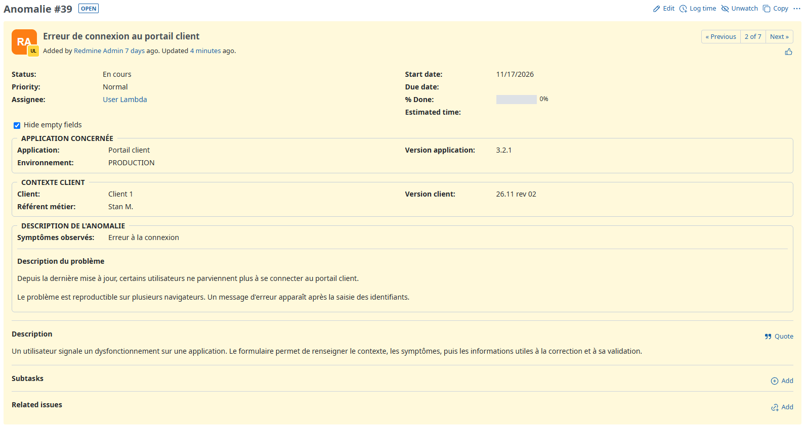
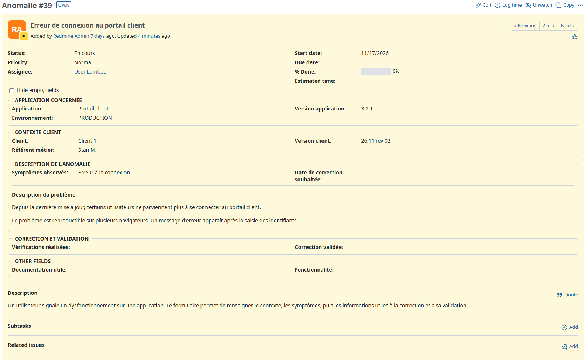
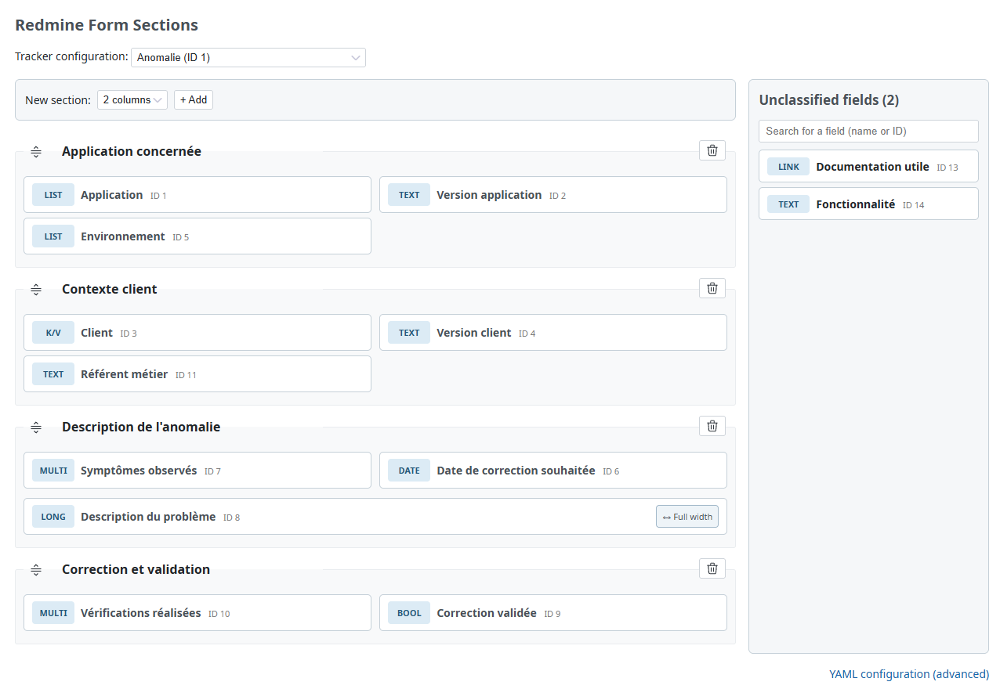
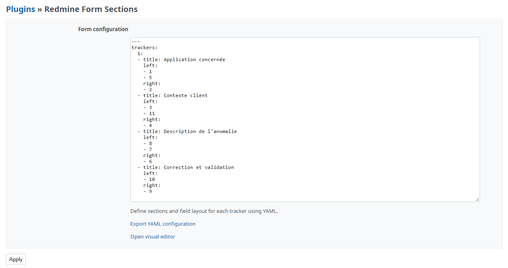

# Redmine Form Sections

[🇫🇷 Documentation en français](README.fr.md)

Redmine Form Sections organizes custom fields when creating, editing, and viewing Redmine issues.

It groups custom fields into named sections, arranged in one or two columns.

**The plugin only affects custom fields.** Native Redmine attributes, the description, and attachments retain their usual layout.

## Features

- Configure one layout per tracker for all three issue views using a built-in visual editor.
- Create, rename, and delete sections; reorder sections with drag and drop.
- Arrange custom fields in one or two columns, and reorder them visually.
- Find unclassified fields using a search box.
- Enable the plugin independently for each project.
- Hide empty fields on the issue view with a filter enabled by default.
- Validate configuration before saving and detect concurrent edits.
- View, edit, and export the YAML configuration when advanced access is needed.
- Use the administration interface in French or English.

The plugin rearranges fields already present in each view. Redmine continues to manage their definitions and values.

## Visual overview

### Native Redmine form

By default, Redmine arranges custom fields in two columns according to their configured order.


### Form organized with Redmine Form Sections

The plugin groups custom fields into functional sections, with a one- or two-column layout.


### Compatibility with Redmine themes

The layout was checked on Redmine 7.0.3 with the default theme and Modern Redmine Theme.


### The filter on the issue view

**Filter enabled (default)**



**Filter disabled (all fields rendered by Redmine)**



### Visual editor preview



## Compatibility

Plugin version: **1.0.0**

| Redmine version | Validation performed |
| --- | --- |
| **4.1.2** | Manual testing of the issue view, including full-width fields. |
| **7.0.3** | Used for development, automated tests, and manual testing, including the issue view and configuration reset. |

Compatibility with Redmine 4.2.x and other versions remains to be verified for the full set of features described here.

## Installation and quick start

Only the `redmine_form_sections` plugin directory is needed. No separate visual-editor plugin or database migration is required.

1. Copy the `redmine_form_sections` directory into Redmine's `plugins` directory.
2. Restart Redmine.
3. In **Administration > Plugins**, check that "Redmine Form Sections" appears in the list.
4. Open **Administration > Form Sections** and save a layout for a tracker.
5. [Enable the module](#enable-for-an-individual-project) in each relevant project.
6. Open an issue with the configured tracker in that project to see the sections.

### Enable for an individual project

1. Open the project.
2. Go to **Settings > Modules**.
3. Enable **Form Sections** (the name depends on the interface language).
4. Save the settings.

On a fresh installation, the configuration is empty (`trackers: {}`). Enabling the module alone leaves issues in their native layout.

## Issue layout

The module must be enabled in the project, and the tracker must have a valid layout with at least one section. The same layout applies when creating, editing, and viewing issues. When no layout applies, Redmine uses its native layout.

Section headings are displayed in uppercase. Their saved text is preserved.

### Creating and editing issues

- The layout sets the order of the sections, the number of columns, and the field order within each column.
- Fields present in the form that are unassigned go into a final "Other fields" section. A section with no fields present is omitted.
- The plugin moves the controls generated by Redmine, including rich-text editors. Redmine still manages field availability for the project and tracker, permissions, validation, and saving field values.

### Viewing issues

- Sections take the place of the ordinary custom fields block, above the description. They contain only the fields Redmine has already rendered for the user. Visibility rules, labels, links, and value formatting are preserved.
- Ordinary fields follow the configured layout and full-width fields appear below their section's columns. An empty full-width field omitted by Redmine stays absent. Rendered fields that are unassigned go into "Other fields".
- **Hide empty fields** is checked by default. It hides empty fields and sections with no remaining visible fields. A value of `0`, "No", or a visible image counts as filled in.
- Uncheck the box to show hidden fields without reloading the page. The box remains available even if all sections are hidden. Each new visit resets the filter to checked, without saving a preference.

## Administration

### Visual editor

The **visual editor is included in Redmine Form Sections 1.0.0**. No additional plugin is needed.

Open **Administration > Form Sections** to configure the sections for a tracker without editing YAML manually.

The editor lets you:

- Select a tracker and manage its sections.
- Create, rename, remove, and reorder sections.
- Drag custom fields between sections and columns, or reorder them within a column.
- Create sections with a one- or two-column layout.
- Identify full-width fields and view or search unclassified fields.
- Save the configuration with validation, including checks for empty sections and titles.
- Detect when the saved configuration has changed since the editor was opened, to avoid accidentally overwriting someone else's edits.

The section and field names shown in the screenshot come from the Redmine instance and may differ from the interface language.

### Advanced YAML configuration

You can view, edit, and export the same configuration as YAML through **Administration > Plugins > Redmine Form Sections > Configure**.

The visual editor also provides a secondary link to **YAML configuration (advanced)**.



Both interfaces use the same saved configuration. Invalid YAML is rejected on save and the interface displays the error. If invalid configuration is already stored in the database, issues use the native Redmine layout. The visual editor displays a warning and blocks saving until the YAML is corrected in the plugin settings.

### Resetting the configuration

- **For one tracker**, remove all of its sections in the visual editor and save. In YAML, remove the tracker entry or give it an empty list, such as `1: []`.
- **For all trackers**, save `trackers: {}` in the advanced YAML settings. In the visual editor, remove the sections and save for each configured tracker.

The next time an affected issue is created, edited, or viewed, it uses the native Redmine layout. You can create a new layout using either interface.

### Exporting the configuration

The administration interface lets you download the YAML configuration.

Only Redmine administrators can export it.

## Upgrading

Before upgrading, we recommend that you:

1. Check that the new plugin version is compatible with your Redmine version.
2. Export the YAML configuration from **Administration > Plugins > Redmine Form Sections > Configure** if your installed version offers an export.
3. Back up the currently installed plugin directory.
4. Plan for a Redmine restart.

### Procedure (including upgrades from 0.1.1)

1. Stop the affected Redmine instances using your usual operational procedure.
2. Replace the `plugins/redmine_form_sections` directory with the new version, keeping exactly the same directory name.
3. Restart Redmine.
4. In **Administration > Plugins**, verify that version 1.0.0 is detected and that only one Redmine Form Sections plugin is installed.
5. Confirm that the existing YAML configuration is preserved, the visual editor opens, and issues display correctly.

### Preserving the configuration

Valid YAML saved from the administration interface is stored in Redmine's database settings and is preserved when you replace the plugin files.

The old `config/form_layouts.yml` file has been removed. It no longer provides initial or fallback configuration. If your layouts were defined only in this file, keep a copy before upgrading, then paste its contents into the advanced YAML settings and save.

### Environments with multiple application servers

When multiple application servers share the `plugins` directory (for example, over NFS), deploy the plugin files only once to the shared storage.

However, all application instances must be restarted to load the new version.

### Database migration

Upgrading from version 0.1.1 to 1.0.0 does not require a database migration. The existing YAML configuration format is retained.

### Rollback

If you encounter a problem:

1. Restore the previous plugin version's directory.
2. Restart the affected Redmine instances.
3. Verify that issues display correctly.

The YAML configuration stored in Redmine is preserved.

## Advanced administration

### Activation

Layouts are configured per tracker. Enable the module in each project where the layout should apply.

#### Enable by default for new projects

Go to **Administration > Settings > Projects** and select **Form Sections** under **Default enabled modules for new projects**. Save the settings.

**This only applies to newly created projects.** Existing projects are not changed.

#### Enable for all existing projects

An administrator can enable the module on every existing project using the Redmine Rails runner. This is preferable to directly inserting records into the database: it uses Redmine's built-in `Project#enable_module!` method, keeps other modules enabled, and skips projects where the module is already active.

**1. Preview how many projects would be affected (read-only):**

```bash
RAILS_ENV=production bundle exec rails runner '
  name = "redmine_form_sections"
  total = Project.count
  missing = 0
  Project.find_each { |project| missing += 1 unless project.module_enabled?(name) }
  puts "#{missing} of #{total} projects require activation"
'
```

**2. After reviewing the result and backing up the database, activate the module:**

```bash
RAILS_ENV=production bundle exec rails runner '
  name = "redmine_form_sections"
  updated = 0
  Project.find_each do |project|
    next if project.module_enabled?(name)
    project.enable_module!(name)
    updated += 1
  end
  puts "Module enabled for #{updated} projects"
'
```

Run these commands from the Redmine application directory, with the same Ruby environment used by Redmine. For Docker installations, run the Rails runner inside the Redmine application container instead. Test the operation on a non-production environment first.

The command includes all existing projects, including archived or closed ones. It does **not** configure the default for future projects; use the previous setting for that.

### Disabling the plugin

Disabling the module preserves the saved section layout.

#### Disable the module for an individual project

1. Open the project.
2. Go to **Settings > Modules**.
3. Uncheck **Form Sections**.
4. Save the settings.

The project immediately returns to Redmine's native layout when creating, editing, and viewing issues.

#### Disable the module for all existing projects

An administrator can disable the module for all existing projects using the Redmine Rails runner.

**1. Check how many projects are affected (read-only):**

```bash
RAILS_ENV=production bundle exec rails runner '
  name = "redmine_form_sections"
  count = EnabledModule.where(name: name).count
  puts "Module enabled for #{count} projects"
'
```

**2. After reviewing the result and backing up the database, disable the module:**

```bash
RAILS_ENV=production bundle exec rails runner '
  name = "redmine_form_sections"
  updated = 0

  Project.find_each do |project|
    next unless project.module_enabled?(name)

    project.disable_module!(name)
    updated += 1
  end

  puts "Module disabled for #{updated} projects"
'
```

Run these commands from the Redmine application directory, using the appropriate Ruby environment. For Docker installations, run the Rails runner inside the Redmine application container.

To prevent automatic activation in newly created projects, also go to **Administration > Settings > Projects** and uncheck **Form Sections** from the default enabled modules.

Disabling the module preserves the YAML configuration and does not delete any custom fields. The module can be re-enabled later without recreating the sections.

### Uninstalling

To completely uninstall Redmine Form Sections:

1. Export the YAML configuration from **Administration > Plugins > Redmine Form Sections > Configure**.
2. Back up the database.
3. Disable the module for existing projects, as described above.
4. Remove **Form Sections** from the default enabled modules for new projects.
5. Stop Redmine.
6. Remove the `plugins/redmine_form_sections` directory.
7. Restart Redmine.

For Docker installations, also remove the plugin volume mapping from the Docker Compose configuration before recreating the container.

The plugin does not use database migrations, so no migration rollback is required.

Uninstalling the plugin does not delete Redmine projects, issues, or custom fields.

Previously saved plugin settings may remain in the database. This procedure intentionally preserves them to facilitate a future reinstallation.

## Configuration reference (YAML)

For everyday administration, use **Administration > Form Sections** and its visual editor. The following reference describes the YAML format used by the plugin, which is also available through **Administration > Plugins > Redmine Form Sections > Configure**.

The plugin uses the configuration stored in its settings. A tracker's layout is shared by the projects where the module is enabled.

### Configuration example

```yaml
trackers:
  1:
    - title: "Application"
      left: [1, 2]
      right: [5]

    - title: "Client"
      left: [3, 4]
      right: [6, 7]
```

In this example:

- `trackers` holds the configuration for each tracker.
- `1` is the Redmine tracker ID.
- `title` defines the section title.
- `left` lists the custom field IDs to display in the left column.
- `right` lists the custom field IDs to display in the right column.

**The numbers in `left` and `right` are Redmine custom field IDs, not field positions in the form.**

Multiple fields can be placed in the same column by separating their IDs with commas. For example:

```yaml
left: [12, 15, 23]
```

This displays custom fields 12, 15, and 23, in that order, in the left column.

**The order of the IDs determines the display order of fields within the column.**

### Finding a custom field ID

In Redmine:

1. Go to **Administration > Custom fields**.
2. Select the relevant custom field.
3. Find its ID in the URL.

Example:

`https://redmine.example.com/custom_fields/123/edit`

In this example, the custom field ID is `123`.

### Column layout

If `right` is declared, the section uses two columns, even when one of the lists is empty.

For example:

```yaml
- title: "Application"
  left: [1, 2]
  right: []
```

The section uses two columns, but only the left column contains fields.

When only `left` is declared, the section uses a single column across the available width:

```yaml
- title: "Application"
  left: [1, 2]
```

The `left` property is required.

A section must declare at least one custom field.

The same custom field cannot be declared more than once for a tracker.

Every section must have a non-empty `title`.

Only `title`, `left`, and `right` are allowed in a section. Unknown properties cause a validation error.

### Full-width custom fields

The plugin respects Redmine's native option for displaying a custom field at full width.

When a custom field is configured as full-width in Redmine:

- It can be declared in either `left` or `right` in the YAML configuration.
- It is displayed below the section's columns, across the available width.
- If it is not declared in any section, it appears at the end of the automatic "Other fields" section.
- If a section contains only full-width fields, no unnecessary column structure is created.

## Tests

The Ruby and Rails tests in `test/unit` and `test/integration` cover YAML validation, reset through both administration interfaces, save conflicts, export, and access restrictions. They also check the new and edit forms, switching trackers, the issue view HTML, and field permissions.

The JavaScript tests cover section planning, grouping with the Redmine 4.1.2 and 7.0.3 HTML structures, filtering, and fallback to the native layout. Run these from the plugin directory with Node.js installed for testing.

```bash
node test/javascript/section_layout_test.js
node test/javascript/issue_show_layout_test.js
```

The integration tests need a Redmine installation and a dedicated test database. The plugin can be installed and used in Redmine without Docker or Node.js.

## Current limitations

- Grouping fields in the issue views uses JavaScript. If the issue view has an unexpected HTML structure, it keeps the native Redmine layout.
- Appearance can vary by theme.

## Author

Julien Maisonnas

## License

Copyright (C) 2026 Julien Maisonnas

Redmine Form Sections is distributed under the terms of the GNU General Public License, version 2 or later (GPL-2.0-or-later).

See [LICENSE](LICENSE) for the full license text.
