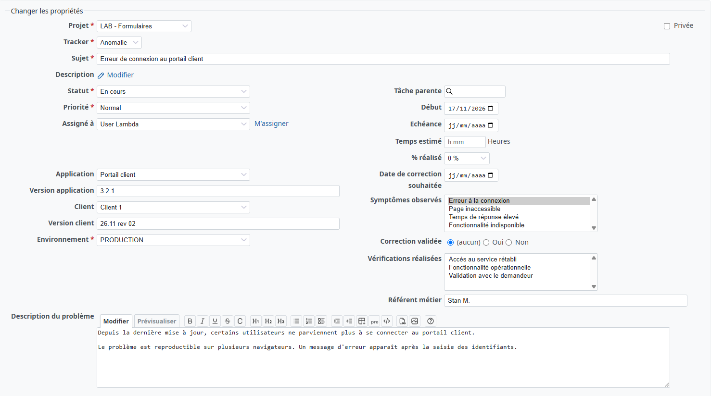
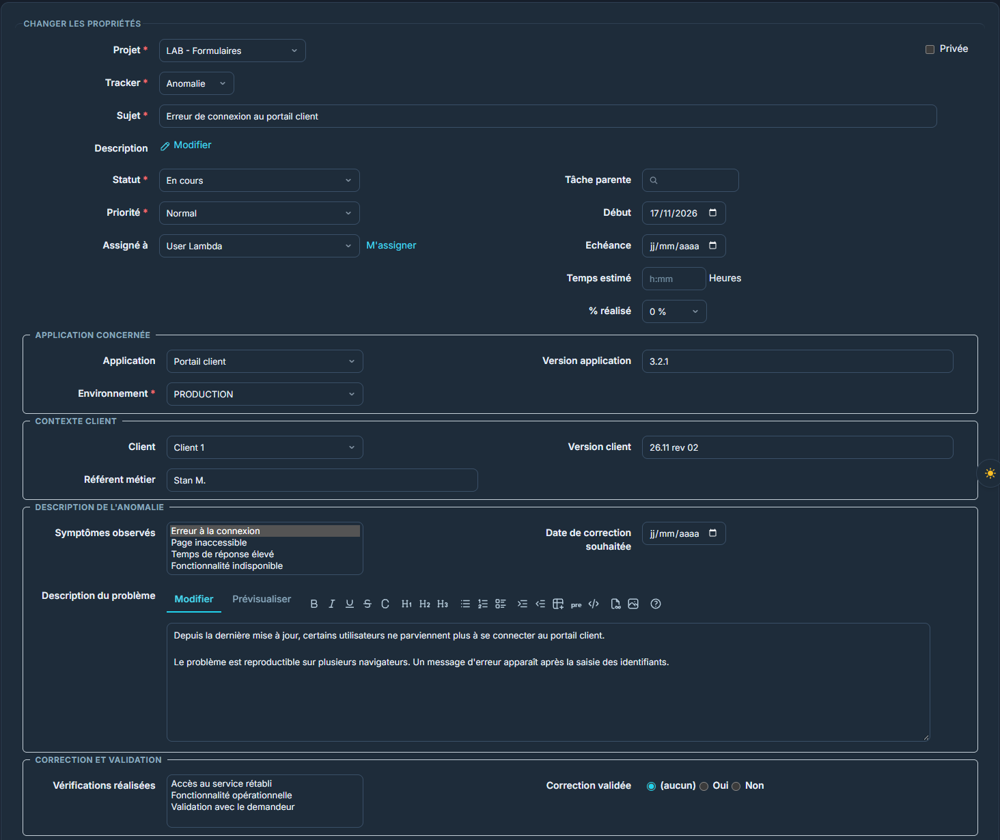
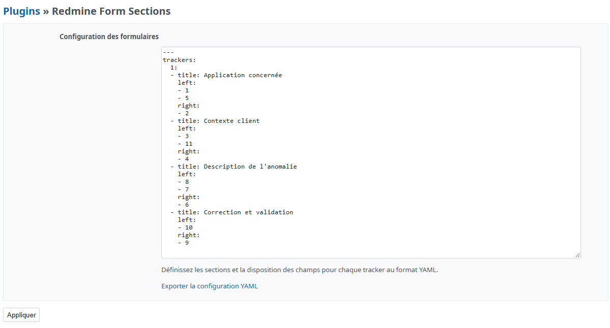

# Redmine Form Sections

[🇫🇷 Documentation en français](README.fr.md)

Redmine Form Sections is a plugin that lets you customize the layout of custom fields in Redmine issue forms.

It groups custom fields into named sections, arranged in one or two columns.

**The plugin only affects custom fields.** Native Redmine fields (Subject, Description, Status, Priority, Assignee, etc.) retain their usual layout.

## Features

- Configure sections for each tracker.
- Arrange fields in one or two columns.
- Enable the plugin independently for each project.
- Manage configuration centrally using YAML.
- Validate configuration before saving.
- Detect custom field IDs declared more than once.
- Export the YAML configuration.
- Use the interface in French or English.

The plugin rearranges existing fields in the form. It does not change their definitions or values.

## Screenshots

### Native Redmine form

By default, Redmine arranges custom fields in two columns according to their configured order.



### Form organized with Redmine Form Sections

The plugin groups custom fields into functional sections, with a one- or two-column layout.


### Compatibility with Redmine themes

Sections adapt to different Redmine themes, including dark themes.



### YAML configuration

Sections can be configured directly from the Redmine administration interface using YAML.



For a graphical drag-and-drop configuration interface, see the companion plugin **Redmine Form Sections PRO**.

## Visual editor — Redmine Form Sections PRO

**Redmine Form Sections PRO** is a companion plugin that makes form administration easier. It provides a graphical interface for configuring sections without editing YAML manually.

### Additional features

- Create, edit, and delete sections.
- Organize custom fields by dragging and dropping them.
- Distribute fields across one or two columns.
- Reorder sections and fields.
- View unassigned fields.
- Search dynamically among unassigned fields.
- Save the configuration.

The PRO plugin relies on Redmine Form Sections FREE.

**The FREE plugin is required:** it applies the configuration to Redmine forms. The PRO plugin adds an administration interface but is not required to use the FREE plugin.

Both plugins can be installed together.

### Behavior

- Trackers without a configuration keep the native Redmine form.
- A tracker configured with an empty list of sections (`1: []`) also keeps the native form.
- Sections containing no fields present in the form are not displayed.
- Fields that have not been assigned to a section are grouped into an "Other fields" section when they are present in the form.
- Fields missing from the form are not added artificially.

## Compatibility

Plugin version: **0.1.1**

Tested Redmine versions:

- Redmine 4.1.2
- Redmine 4.2.6
- Redmine 7.0.3

The plugin has been tested with different themes, including the default Redmine theme.

Compatibility with other Redmine versions is not guaranteed.

## Installation

1. Copy the `redmine_form_sections` directory into Redmine's `plugins` directory.
2. Restart Redmine.
3. In **Administration > Plugins**, check that "Redmine Form Sections" appears in the list.

No database migration is required for this plugin version.

## Upgrading

Before upgrading, we recommend that you:

1. Check that the new plugin version is compatible with your Redmine version.
2. Export the YAML configuration from **Administration > Plugins > Redmine Form Sections > Configure**.
3. Back up the currently installed plugin directory and the `config/form_layouts.yml` file if it has been customized.
4. Plan for a Redmine restart.

### Procedure

1. Stop the affected Redmine instances using your usual operational procedure.
2. Replace the `plugins/redmine_form_sections` directory with the new version, keeping exactly the same directory name.
3. Restart Redmine.
4. In **Administration > Plugins**, verify that the new version is detected.
5. Confirm that the existing YAML configuration has been preserved and that customized forms work correctly.

### Preserving the configuration

The YAML configuration saved from the administration interface is stored in Redmine's settings in the database.

It is therefore normally preserved when replacing the plugin files.

**Important:** if `config/form_layouts.yml` was edited directly, preserve these changes when upgrading.

Exporting the YAML configuration beforehand provides an additional backup that can be used to restore it easily.

### Environments with multiple application servers

When multiple application servers share the `plugins` directory (for example, over NFS), deploy the plugin files only once to the shared storage.

However, all application instances must be restarted to load the new version.

### Database migration

Upgrading from version 0.1.0 to 0.1.1 does not require a database migration.

### Rollback

If you encounter a problem:

1. Restore the previous plugin version's directory.
2. Restart the affected Redmine instances.
3. Verify that the forms work correctly.

The YAML configuration stored in Redmine is preserved.

## Activation

The plugin must be enabled in each project where it should be used.

1. Open the project.
2. Go to **Settings > Modules**.
3. Enable **Form customization** (the module label may vary with the interface language).
4. Save the settings.

Projects where the module is disabled retain Redmine's native behavior.

## Configuration

Go to **Administration > Plugins > Redmine Form Sections > Configure**.

Custom field layout is defined in YAML.

Configuration stored in the plugin settings takes precedence.

The `config/form_layouts.yml` file provides the initial configuration and serves as a fallback when no usable saved configuration is available.

Configuration is shared by all projects using the same tracker.

### Configuration example

```yaml
trackers:
  1:
    - title: "Application"
      left: [1, 2]
      right: [5]

    - title: "Client"
      left: [3, 4]
      right: [6, 7]
```

In this example:

- `trackers` holds the configuration for each tracker.
- `1` is the Redmine tracker ID.
- `title` defines the section title.
- `left` lists the custom field IDs to display in the left column.
- `right` lists the custom field IDs to display in the right column.

**The numbers in `left` and `right` are Redmine custom field IDs, not field positions in the form.**

Multiple fields can be placed in the same column by separating their IDs with commas. For example:

```yaml
left: [12, 15, 23]
```

This displays custom fields 12, 15, and 23, in that order, in the left column.

**The order of the IDs determines the display order of fields within the column.**

### Finding a custom field ID

In Redmine:

1. Go to **Administration > Custom fields**.
2. Select the relevant custom field.
3. Find its ID in the URL.

Example:

`https://redmine.example.com/custom_fields/123/edit`

In this example, the custom field ID is `123`.

### Column layout

If `right` is declared, the section uses two columns, even when one of the lists is empty.

For example:

```yaml
- title: "Application"
  left: [1, 2]
  right: []
```

The section uses two columns, but only the left column contains fields.

When only `left` is declared, the section uses a single column across the available width:

```yaml
- title: "Application"
  left: [1, 2]
```

The `left` property is required.

A section must declare at least one custom field.

The same custom field cannot be declared more than once for a tracker.

Every section must have a non-empty `title`.

Only `title`, `left`, and `right` are allowed in a section. Unknown properties cause a validation error.

### Full-width custom fields

The plugin respects Redmine's native option for displaying a custom field across the full width of the form.

When a custom field is configured as full-width in Redmine:

- It can be declared in either `left` or `right` in the YAML configuration.
- It is displayed below the section's columns, across the available width.
- If it is not declared in any section, it appears at the end of the automatic "Other fields" section.
- If a section contains only full-width fields, no unnecessary column structure is created.

The plugin preserves the HTML controls generated by Redmine, including rich-text editors.

This customization applies to custom fields only. Native Redmine fields are not rearranged.

## Exporting the configuration

The administration interface lets you download the YAML configuration.

Only Redmine administrators can export it.

## Tests

The source code includes unit and integration tests covering, among other things:

- YAML configuration validation.
- Detection of invalid configurations.
- Administration behavior.
- Export functionality and access restrictions.

These tests are not required for normal plugin operation.

## Current limitations

- Sections are configured per tracker and shared by every project using that tracker.
- Native Redmine fields (Subject, Description, Status, Priority, etc.) cannot be rearranged.
- Only custom fields actually present in a form are reorganized.
- The appearance depends on the Redmine theme; minor visual differences may occur.
- Compatibility has only been verified with the Redmine versions listed above.

A graphical section editor is available through the companion plugin **Redmine Form Sections PRO**.

## Author

Julien Maisonnas

## License

Copyright (C) 2026 Julien Maisonnas

Redmine Form Sections is distributed under the terms of the GNU General Public License, version 2 or later (GPL-2.0-or-later).

See [LICENSE](LICENSE) for the full license text.
